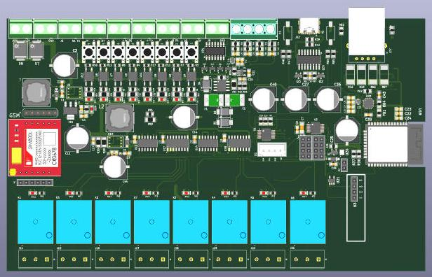
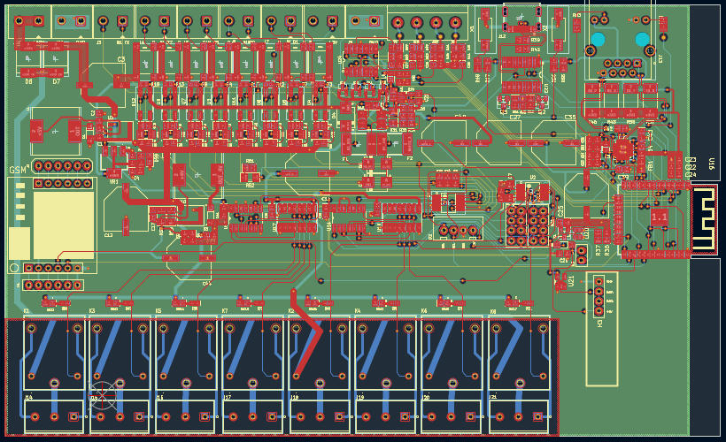
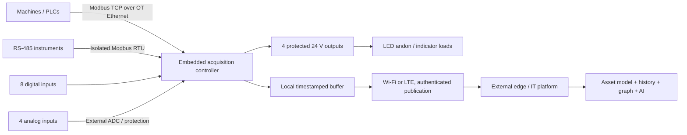

# Smart Manufacturing Edge · ESP32 PLC-style controller with Ethernet

> **Status: architecture definition (RevA). Not released for fabrication.**
> There is no merged schematic, routed PCB, approved BOM or firmware yet.

An industrial edge controller for machine data acquisition: one Ethernet
port on the OT network, Wi-Fi or LTE upstream, digital and analog inputs,
isolated RS-485 and four protected 24 V outputs for Andon lamps. It reads
machines over Modbus, timestamps and buffers the data, and publishes it to
an external platform (asset model, history, knowledge graph, AI).

This repository holds the engineering work done **before** layout:
requirements, architecture, output stage selection, implementation plan and
an audit of the reference board it learns from.

## Reference board

The new design starts from a prototype I ported to KiCad 10 and reviewed: an
ESP32 I/O controller with LAN8720A Ethernet, 8 relay outputs, digital and
analog inputs, RS-485 and a GSM slot.

| 3D view (KiCad) | Layout |
|---|---|
|  |  |

The reference board is based on the **KinCony KC868-A8S** hardware
(original design by [KinCony](https://www.kincony.com)), imported from
Altium and modified. Its design files are not redistributed here; only my
review of it is. See
[lessons from the reference board](docs/04-lessons-from-reference-board/reference-board-issues.md)
for what the audit found, including a 4 V regulator wired with SW and FB
swapped, the DRC/ERC baseline and the Ethernet PHY checks.

## What changes in the new design

| Area | Reference board | Smart Manufacturing Edge RevA (proposed) |
|---|---|---|
| Supply | 12 V | 24 V DC industrial standard, reverse polarity and surge protection |
| Outputs | 8 relays | 4 protected high-side 24 V outputs (0.5 A target each) for LED Andon |
| Inputs | 8 DI + analog | 8 isolated 24 V DI, 2 x 4-20 mA + 2 x 0-10 V with external ADC |
| Fieldbus | RS-485 | Galvanically isolated RS-485 (Modbus RTU) |
| Networks | Ethernet + GSM | 1 Ethernet (OT) + Wi-Fi + LTE (upstream), no IP bridging between them |
| Data | n/a | Local timestamped buffer, MQTT over TLS, sequence numbers and quality |

## Architecture

## Documents

| | |
|---|---|
| [Requirements and open decisions](docs/01-requirements/requirements.md) | targets per function, firmware contract, what is still undecided |
| [Architecture](docs/02-architecture/architecture.md) | block diagram, network separation, MCU candidates |
| [Output stage selection](docs/02-architecture/output-selection.md) | relays vs high-side switches for Andon loads |
| [Implementation plan](docs/03-engineering-plan/implementation-plan.md) | steps from schematic to measured acceptance |
| [Lessons from the reference board](docs/04-lessons-from-reference-board/reference-board-issues.md) | audit of the ported KiCad board |

## Roadmap

- [x] Port the reference board to KiCad 10 and audit it (DRC, ERC, parity, power stage)
- [x] Requirements, architecture and output selection
- [ ] Validate loads, sensor list, LTE region and pin budget
- [ ] New schematic (power, MCU, Ethernet, LTE, RS-485, DI, AI, outputs)
- [ ] Layout, DRC, DFM review
- [ ] Prototype, bring-up and measured acceptance
- [ ] Firmware: Modbus TCP/RTU client, buffer, MQTT/TLS publication

## Related

* [iiot-protocols-examples](https://github.com/MatheusEduGarcia/iiot-protocols-examples): the Modbus, MQTT and buffering concepts this controller implements.
* [automation-portfolio](https://github.com/MatheusEduGarcia/automation-portfolio): ESP32 Andon and OEE prototype.

## Author

**Matheus Garcia**, Control and Automation Engineer.
[LinkedIn](https://www.linkedin.com/in/matheuseduardorgarcia)

Documentation licensed under [CC BY 4.0](https://creativecommons.org/licenses/by/4.0/).
