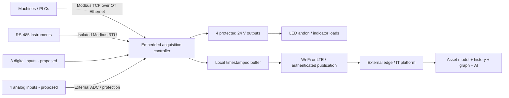

# Combined architecture

## Integration decisions

Use the A8S reference for I/O concepts and the gateway reference for Ethernet/cellular concepts. Re-engineer the power supply, protection, MCU pin allocation and board placement as a new design. Do not copy the known A8S 4 V regulator error or the gateway modem placeholder footprint.

One Ethernet interface is sufficient for the confirmed topology. No second Ethernet or SPI Ethernet controller is included. Keep OT traffic on Ethernet; bind upstream sessions to Wi-Fi or cellular and define route/DNS selection explicitly. Validate that default-route changes do not break OT polling. There is no automatic IP bridge between interfaces.

ESP32 is a candidate, not a frozen part number. The gateway reference allocates most GPIOs. Before schematic capture, budget Ethernet RMII, modem UART/control/status, RS-485, programming, ADC bus, output enables and diagnostic pins, interrupt lines and boot straps. Use external ADC and I/O expansion where appropriate; pulse inputs need a path that meets the required capture rate. Hardware output disable must not depend solely on an I/O-expander transaction.

Validate CPU/RAM/TLS/buffer requirements with Ethernet polling, Wi-Fi or cellular publishing and four-output diagnostics active simultaneously. Use an external Linux edge system for graph, ontology and broad OPC UA integration.

## Power domains

24 V input -> protected field supply for outputs; separately engineered DC/DC rails for MCU/PHY and LTE modem. Budget all four loads, cellular transmit bursts and inrush concurrently. Determine isolation boundaries for RS-485, analog/digital inputs and shared field returns. A high-side output switch does not by itself provide galvanic isolation.

Do not transplant the solar charger, lead-acid battery circuit or passive PoE into the initial baseline. GNSS remains optional and uncommitted. Keep Wi-Fi/BLE and LTE antenna requirements in the enclosure study.

## Reference state

Gateway PCB inspection: 143 footprint records, zero track segments and zero vias. The original documentation describes 139 components, which must be reconciled by electrical versus mechanical item classification. The modem BOM footprint is explicitly a placeholder. Source schematic changes postdate the PCB. Reconcile netlist and footprints before reuse. No new ERC/DRC pass is claimed.

A8S prepared copy: 223 components and documented unresolved electrical/manufacturing issues. Its routed PCB cannot simply be shrunk or combined with the gateway placement. Previous review evidence is included separately.
